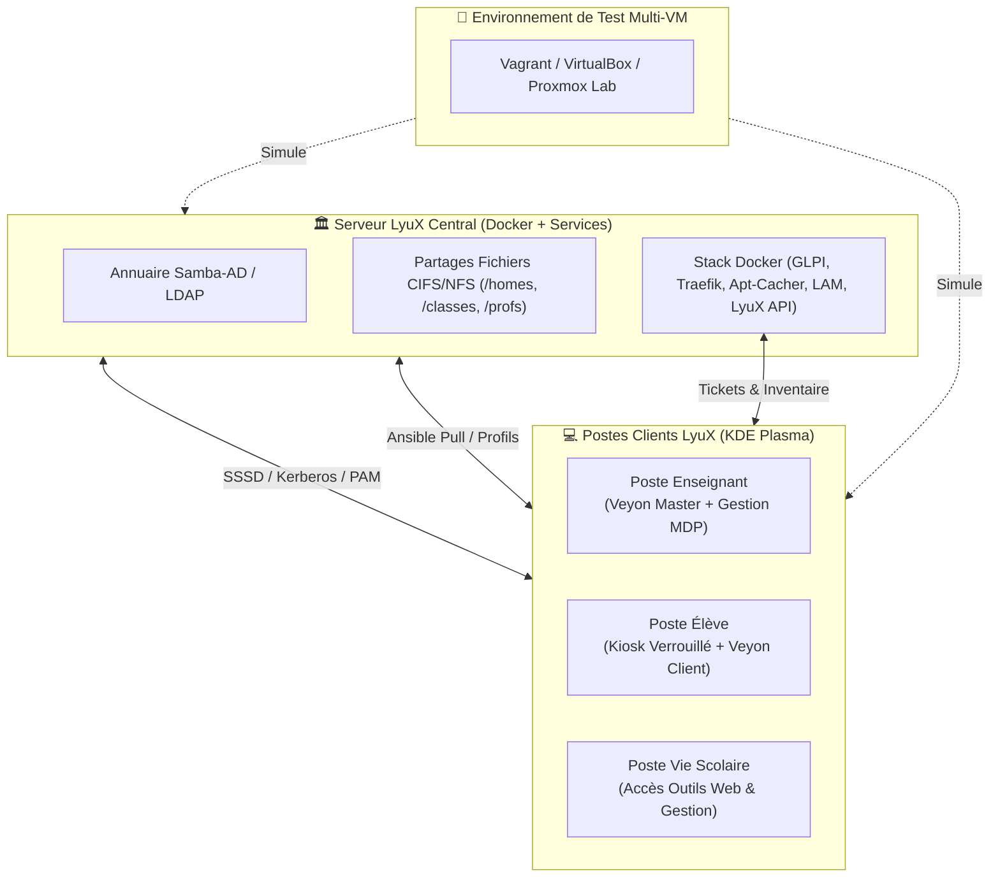

# 🐧 LyuX — Écosystème Opération Manchot
> **Infrastructure libre, moderne et centralisée pour la migration des lycées vers Linux.**

Bienvenue dans le dépôt central du projet **LyuX (Opération Manchot)**.  
Ce monorepo regroupe l'ensemble des briques matérielles, logicielles, d'automatisation et de gestion nécessaires pour transformer le parc informatique d'un lycée en un écosystème Linux fluide, élégant, sécurisé et totalement automatisé.

---

## 🏛️ Architecture Globale & Philosophie

LyuX repose sur 5 piliers fondamentaux :
1. **Un compte par personne, géré de façon centralisée** (Annuaire LDAP/Samba-AD, SSO, SSSD).
2. **Les données sur le serveur, pas sur le poste** (Montage dynamique transparent `pam_mount` des dossiers `/home` et partages de classes).
3. **Des postes identiques et remplaçables** (Enrôlement express par clé USB minimale ou PXE, aucun état local critique).
4. **Automatisation totale** (Déploiement et profils de salles pilotés par Ansible, gestion des paquets en cache local).
5. **Expérience utilisateur soignée & soignée** (Bureau KDE Plasma verrouillé par Kiosk, widgets de bienvenue et de signalement de panne direct vers GLPI).

---

## 📦 Les Projets / Dépôts du Système

Le projet est découpé en plusieurs sous-projets modulaires, chacun disposant de son code, de sa configuration et de sa documentation exhaustive :

| Sous-Projet | Dossier | Description & Rôle |
| :--- | :--- | :--- |
| **`lyux-server-infra`** | [`projects/lyux-server-infra/`](file:///g:/Pro/.Dev/Lycee/Op%C3%A9rationManchot/projects/lyux-server-infra) | Infrastructure serveur : stack Docker Compose (Traefik, GLPI, Apt-Cacher-NG, LAM, Uptime Kuma) et configurations Samba/LDAP. |
| **`lyux-ansible`** | [`projects/lyux-ansible/`](file:///g:/Pro/.Dev/Lycee/Op%C3%A9rationManchot/projects/lyux-ansible) | Playbooks et rôles Ansible : socle commun (`lyux-base`), verrouillage (`lyux-kiosk`), et profils par salle/matière (Maths/NSI, Sciences, Techno, etc.). |
| **`lyux-server-api`** | [`projects/lyux-server-api/`](file:///g:/Pro/.Dev/Lycee/Op%C3%A9rationManchot/projects/lyux-server-api) | API de contrôle (FastAPI) : distribution des profils de machines, gestion des codes d'enrôlement temporaires (OTP) et passerelles webhooks. |
| **`lyux-welcome`** | [`projects/lyux-welcome/`](file:///g:/Pro/.Dev/Lycee/Op%C3%A9rationManchot/projects/lyux-welcome) | Assistant de 1er démarrage (PyQt6) : tutoriel interactif personnalisé selon le rôle (Élève, Prof, Admin) à l'ouverture de session. |
| **`lyux-report`** | [`projects/lyux-report/`](file:///g:/Pro/.Dev/Lycee/Op%C3%A9rationManchot/projects/lyux-report) | Widget "Signaler un problème" (PyQt6) : création instantanée de tickets préremplis avec capture d'écran vers l'API GLPI. |
| **`lyux-enrollment`** | [`projects/lyux-enrollment/`](file:///g:/Pro/.Dev/Lycee/Op%C3%A9rationManchot/projects/lyux-enrollment) | Assistant d'enrôlement de machine pour clé USB minimale / PXE : choix de la salle, nom d'hôte automatique et tirage du profil Ansible. |
| **`lyux-lab-vm`** | [`projects/lyux-lab-vm/`](file:///g:/Pro/.Dev/Lycee/Op%C3%A9rationManchot/projects/lyux-lab-vm) | Environnement virtuel de test prêt à l'emploi (Vagrantfile & configs) pour faire tourner 4 VMs en réseau privé (Serveur, Prof, Élève, Vie-Sco). |

---

## 🚀 Démarrage Rapide (1 Clic)

### ⚡ Accès Immédiat au Portail Web LyuX Hub
Le serveur Docker tourne déjà sur votre machine. Vous pouvez tester l'ensemble du système en un clic :
- **Portail Web Moderne & Enrôlement Express** : Ouvrez **`http://localhost:8000`** dans votre navigateur.
- **Lanceur Windows 1-Clic** : Double-cliquez sur **`Lancer-LyuX.bat`** (ou lancez `.\lancer-lyux.ps1`).

### 📱 Fonctionnalités du Hub LyuX :
1. **⚡ Enrôlement Express en 2s** : Branchez un PC, choisissez la salle (Classe 1 NSI ou Classe 2 Sciences) et cliquez sur *Déployer* — attribution automatique du nom d'hôte (`b204-pc01`), profil Ansible, montages Samba et compte utilisateur.
2. **🏫 Supervision des 2 Classes (Veyon Master)** : Visualisation en direct des écrans élèves, verrouillage/déverrouillage en 1 clic, diffusion de messages.
3. **👥 Annuaire des Utilisateurs** : Comptes élèves, profs, vie scolaire préconfigurés avec mots de passe et test direct de session.
4. **💻 Simulateur KDE Plasma** : Test de l'espace personnel réseau `//homes`, des dossiers partagés de cours `//classes` et du widget de signalement GLPI.
5. **📊 Tableau de Bord Infrastructure** : Accès direct à Traefik (`:8888`), GLPI (`:8088`), Uptime Kuma (`:3001`), LAM (`:8088`) et Apt-Cacher (`:3142`).

---

## 📚 Documentation Complète
Pour une lecture approfondie de la méthodologie de migration, des contraintes matérielles, du RGPD et du choix des logiciels de substitution, consultez le dossier [`docs/`](file:///g:/Pro/.Dev/Lycee/Op%C3%A9rationManchot/docs) :
* [Architecture technique détaillée](file:///g:/Pro/.Dev/Lycee/Op%C3%A9rationManchot/docs/architecture.md)
* [Matrice de compatibilité logicielle](file:///g:/Pro/.Dev/Lycee/Op%C3%A9rationManchot/docs/logiciels-compatibilite.md)
* [Guide de déploiement en salle pilote](file:///g:/Pro/.Dev/Lycee/Op%C3%A9rationManchot/docs/guide-deploiement-salle.md)
* [Conformité RGPD & Cadre Légal](file:///g:/Pro/.Dev/Lycee/Op%C3%A9rationManchot/docs/rgpd-conformite.md)
