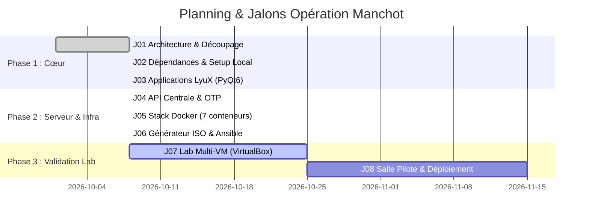

# 🗺️ Feuille de Route & Validation des Jalons — LyuX
> **Document de suivi du projet de migration LyuX (Opération Manchot).**  
> Ce document permet de suivre l'état d'avancement, de valider chaque étape clé (jalon) et de savoir exactement où en est le développement.

---

## 📊 Tableau de Bord d'Avancement Global

| Jalon | Intitulé du Chantier | Responsable / Scope | Statut | Date / Cible |
| :---: | :--- | :--- | :---: | :---: |
| **J01** | **Architecture & Découpage Modulaire** | Structure des dépôts & Docs | ✅ **Validé** | Oct 2026 |
| **J02** | **Installation Dépendances & Tests Développeur** | Dépendances Python & Tests Unitaires | ✅ **Validé** | Oct 2026 |
| **J03** | **Applications Clientes LyuX (UI/UX)** | `lyux-welcome`, `lyux-report`, `lyux-enrollment` | ✅ **Validé** | Oct 2026 |
| **J04** | **API Centrale & Orchestration Serveur** | `lyux-server-api` (FastAPI + Docker) | ✅ **Validé** | Oct 2026 |
| **J05** | **Stack Serveur Docker & Stockage Réseau** | `docker-compose`, GLPI, Traefik, LAM, Uptime Kuma | ✅ **Validé** | Oct 2026 |
| **J06** | **Générateur d'ISO Légère & Profils Ansible** | `lyux-iso-builder` & `lyux-ansible` | ✅ **Validé** | Oct 2026 |
| **J07** | **Lab Virtuel Multi-VM (VirtualBox)** | 3 VMs créées avec Disques VDI & Réseau Interne | 🟡 **Prêt au boot** | Oct 2026 |
| **J08** | **Validation Salle Pilote & Recette Finale** | Tests réels, Veyon, Impression, Rollback | ⚪ À venir | Déc 2026 |

---

## 🎯 Détail des Jalons & Critères d'Acceptation

---

### 🟢 Jalon 07 — Lab Virtuel Multi-VM (VirtualBox)
- [x] Configuration du réseau interne isolé `LyuX-Lab-Net`.
- [x] Création et enregistrement des 3 machines virtuelles dans Oracle VirtualBox :
  * **`LyuX-Server`** : 4 Go RAM, 2 vCPUs, Disque VDI 40 Go, Double carte réseau (Interne + NAT).
  * **`LyuX-Client-Prof`** : 3 Go RAM, 2 vCPUs, Disque VDI 25 Go, Double carte réseau.
  * **`LyuX-Client-Eleve`** : 2 Go RAM, 2 vCPUs, Disque VDI 20 Go, Double carte réseau.
- [ ] Démarrage et installation de l'OS.
- [ ] Test d'itinérance de session et supervision Veyon.
