# 🐧 Guide Utilisateur & Manuel d'Administration — LyuX (Opération Manchot)

> **Infrastructure Linux Lycée : Standardisée, Moderne, Élégante & 100% Open Source**  
> *Zéro développement "fait-maison" : Assemblage des meilleurs standards de l'industrie (Cockpit, Samba-AD, LDAP Account Manager, KDE Plasma, Calamares, Veyon, GLPI, Uptime Kuma).*

---

## 📑 Sommaire

1. [Architecture & Philosophie du Système](#1-architecture--philosophie-du-système)
2. [Tableau de Bord des Services Web & Accès Directs](#2-tableau-de-bord-des-services-web--accès-directs)
3. [Annuaire des Utilisateurs & Comptes de Test](#3-annuaire-des-utilisateurs--comptes-de-test)
4. [Les 2 Salles Pilotes Préconfigurées](#4-les-2-salles-pilotes-préconfigurées)
5. [Supervision Pédagogique avec Veyon Master](#5-supervision-pédagogique-avec-veyon-master)
6. [Démarrage Rapide & Lab Virtuel VirtualBox](#6-démarrage-rapide--lab-virtuel-virtualbox)
7. [Déploiement Nouveau Poste : Modèle Image Master & Calamares OOBE](#7-déploiement-nouveau-poste--modèle-image-master--calamares-oobe)
8. [Stockage Centralisé, Partages de Classes & Quotas](#8-stockage-centralisé-partages-de-classes--quotas)
9. [Gestion des Incidents & Inventaire avec GLPI](#9-gestion-des-incidents--inventaire-avec-glpi)
10. [FAQ & Dépannage Courant](#10-faq--dépannage-courant)

---

## 1. Architecture & Philosophie du Système

**LyuX** a été conçu pour éliminer la complexité des déploiements scolaires traditionnels et remplacer les anciens environnements propriétaires par un écosystème Linux pérenne, robuste et sécurisé :

- **Centralisation Totale** : Tous les utilisateurs, groupes et quotas sont gérés dans l'annuaire Samba-AD / LDAP. Aucun état critique n'est stocké localement sur les postes.
- **Expérience Graphique Moderne** : Finis les installateurs Debian textuels des années 90 sur fond bleu. Le système s'allume directement sur une interface graphique fluide (**KDE Plasma sous X11** avec thème sobre et gestionnaire de session **SDDM**).
- **Zéro "Fait-Maison"** : Intégration stricte d'outils éprouvés et maintenus par la communauté mondiale du logiciel libre.

```mermaid
flowchart TD
    subgraph SERVEUR ["🏛️ Serveur Central LyuX (Docker & Services Réseau)"]
        AUTH["Annuaire Samba-AD / LDAP"]
        LAM_SRV["LDAP Account Manager (:8082)"]
        COCKPIT_SRV["Cockpit Web Admin (:9090)"]
        GLPI_SRV["GLPI Helpdesk (:8085)"]
        KUMA_SRV["Uptime Kuma (:3001)"]
        SHARES["Partages NFS / CIFS (//homes & //classes)"]
    end

    subgraph SALLE_B204 ["🏫 Salle B204 — NSI / Informatique"]
        PROF_B204["b204-prof (Veyon Master)"]
        PC1_B204["b204-pc01 (KDE + Veyon Service)"]
        PC2_B204["b204-pc02 (KDE + Veyon Service)"]
    end

    subgraph SALLE_S102 ["🔬 Salle S102 — Sciences / Physique-SVT"]
        PROF_S102["s102-prof (Veyon Master)"]
        PC1_S102["s102-pc01 (KDE + Veyon Service)"]
        PC2_S102["s102-pc02 (KDE + Veyon Service)"]
    end

    AUTH <-->|SSSD / Kerberos / SDDM| SALLE_B204 & SALLE_S102
    SHARES <-->|pam_mount auto à la session| SALLE_B204 & SALLE_S102
    PROF_B204 -.->|Supervision RSA| PC1_B204 & PC2_B204
    PROF_S102 -.->|Supervision RSA| PC1_S102 & PC2_S102
```



---

## 2. Tableau de Bord des Services Web & Accès Directs

Tous les services du serveur sont déjà opérationnels en conteneurs Docker et accessibles depuis votre navigateur sur votre machine locale :

| Service | Rôle & Fonction | URL d'Accès Direct | Identifiants par Défaut |
| :--- | :--- | :--- | :--- |
| 🌐 **LyuX Web Hub** | Portail d'accueil, simulateur et enrôlement express | [http://localhost:8000](http://localhost:8000) | *Accès direct sans mot de passe* |
| 👥 **LDAP Account Manager (LAM)** | Gestion des comptes élèves, profs, classes et quotas | [http://localhost:8082](http://localhost:8082) | Profil : `lyux` / MDP : `lamadmin` |
| 🎫 **GLPI Helpdesk & Parc** | Gestion des tickets d'incidents et inventaire matériel | [http://localhost:8085](http://localhost:8085) | Login : `glpi` / MDP : `glpi` |
| 📈 **Uptime Kuma** | Supervision en direct de l'état des serveurs et services | [http://localhost:3001](http://localhost:3001) | *Interface de monitoring en temps réel* |
| 🔀 **Traefik Proxy** | Reverse proxy centralisé et routage de tous les sous-domaines | [http://localhost:8888](http://localhost:8888) | *Dashboard de routage réseau* |
| 🎛️ **Cockpit Project** | Administration système du serveur Linux (disques, logs, réseau) | Port `9090` (Linux hôte/VM) | Login : `root` / MDP : défini à l'install |

---

## 3. Annuaire des Utilisateurs & Comptes de Test

Les comptes de test suivants sont pré-provisionnés dans l'annuaire central et prêts à être utilisés sur les postes clients :

### 👨‍🎓 Comptes Élèves
| Utilisateur | Identifiant (Login) | Mot de Passe | Classe / Salle | Dossier Personnel Réseau | Partage Classe |
| :--- | :--- | :--- | :--- | :--- | :--- |
| **Lucas Martin** | `lucas.martin` | `Eleve2026!` | 1G1 NSI (B204) | `~/Espace_Personnel` (5 Go) | `~/Partages_Classes/1G1_NSI` |
| **Emma Bernard** | `emma.bernard` | `Eleve2026!` | 1G1 NSI (B204) | `~/Espace_Personnel` (5 Go) | `~/Partages_Classes/1G1_NSI` |
| **Hugo Dubois** | `hugo.dubois` | `Eleve2026!` | 1G2 Sciences (S102) | `~/Espace_Personnel` (5 Go) | `~/Partages_Classes/1G2_Sciences` |
| **Léa Thomas** | `lea.thomas` | `Eleve2026!` | 1G2 Sciences (S102) | `~/Espace_Personnel` (5 Go) | `~/Partages_Classes/1G2_Sciences` |

### 👩‍🏫 Comptes Enseignants & Vie Scolaire
| Utilisateur | Identifiant (Login) | Mot de Passe | Rôle & Salle | Droits Spécifiques |
| :--- | :--- | :--- | :--- | :--- |
| **M. Thomas Durand** | `thomas.durand` | `Prof2026!` | Enseignant NSI (B204) | Veyon Master B204, Écriture dans *Distribution*, Accès *Dépôt de devoirs* |
| **Mme Sophie Leroy** | `sophie.leroy` | `Prof2026!` | Enseignante Sciences (S102) | Veyon Master S102, Écriture dans *Distribution*, Accès *Dépôt de devoirs* |
| **Claire Fontaine** | `claire.viesco` | `VieSco2026!` | Responsable Vie Scolaire | Gestion des absences, accès GLPI, réinitialisation de mots de passe |
| **Administrateur IT** | `lyux-admin` | `LyuxAdmin2026!` | Administrateur Système | Droits `sudo`, accès Cockpit, LAM et configuration globale |

---

## 4. Les 2 Salles Pilotes Préconfigurées

L'écosystème comprend deux profils de salles pédagogiques complètes, adaptées aux matières enseignées :

### 🏫 Salle 1 : Salle B204 (Informatique / NSI & Mathématiques)
- **Poste Enseignant** : `b204-prof`
  - Logiciel de supervision : **Veyon Master** (avec clé privée de contrôle de la salle B204).
  - Profil applicatif : Python 3.12, **VS Code**, **Thonny IDE**, **GeoGebra**, LibreOffice Suite.
- **Postes Élèves** : `b204-pc01`, `b204-pc02`
  - Logiciel de réception : **Veyon Service** (daemon en arrière-plan).
  - Profil applicatif : Thonny, VS Code, Idle, Turtle, SQLite Browser, Navigateur Firefox avec marque-pages pédagogiques.

### 🔬 Salle 2 : Salle S102 (Sciences Expérimentales / Physique-Chimie & SVT)
- **Poste Enseignant** : `s102-prof`
  - Logiciel de supervision : **Veyon Master** (avec clé privée de contrôle de la salle S102).
  - Profil applicatif : **Avogadro** (modélisation moléculaire), **Tracker** (analyse vidéo de mouvements), **Audacity**, LibreOffice Calc.
- **Postes Élèves** : `s102-pc01`, `s102-pc02`
  - Logiciel de réception : **Veyon Service**.
  - Profil applicatif : Avogadro, Tracker, Stellarium, PyMOL, GDM (Graphique & Mesures).

---

## 5. Supervision Pédagogique avec Veyon Master

Le logiciel open source **Veyon** remplace avantageusement les solutions payantes de gestion de classe (comme NetSupport School) :

1. **Authentification par Clés Asymétriques RSA** :
   - Clé publique (`0444`) déployée sur tous les postes élèves : `veyon-keys.public.key`.
   - Clé privée (`0440`) présente uniquement sur le poste enseignant et restreinte au groupe `professeurs`.
2. **Fonctionnalités Disponibles pour l'Enseignant** :
   - **Vue Mosaïque en Temps Réel** : Visualisation simultanée des écrans de tous les élèves de la salle.
   - **Verrouillage des Écrans (1 Clic)** : Affiche un écran de pause invitant les élèves à écouter les consignes.
   - **Démonstration Professeur** : Diffusion en direct de l'écran du professeur sur tous les postes élèves.
   - **Partage & Récupération de Fichiers** : Envoi de documents directement sur le bureau des élèves.
   - **Arrêt / Redémarrage Collectif** : Extinction de toute la salle en fin de journée en un seul clic.

---

## 6. Démarrage Rapide & Lab Virtuel VirtualBox

### 🚀 Lancement Rapide (Windows)
Pour lancer le hub web et l'environnement de contrôle :
1. Double-cliquez sur le fichier **`Lancer-LyuX.bat`** situé à la racine du projet (ou exécutez `.\lancer-lyux.ps1` dans PowerShell).
2. Le portail d'accueil s'ouvre automatiquement sur **`http://localhost:8000`**.

### 🧪 Déploiement Automatisé des VMs dans VirtualBox
Si vous souhaitez déployer les 5 machines virtuelles de test (2 postes B204, 2 postes S102, 1 poste Vierge) :
```powershell
# Exécutez le script de déploiement automatique non interactif :
powershell -ExecutionPolicy Bypass -File projects/lyux-lab-vm/scripts/setup-2classes-vms.ps1
```
- Le script configure automatiquement chaque machine avec **2 Go de RAM**, **2 vCPUs**, un disque VDI de **20 Go**, le contrôleur réseau NAT et lance l'installation automatique `unattended` sans aucune question textuelle manuelle.

### 🔍 Diagnostic Rapide du Lab
Pour vérifier l'état de votre lab virtuel :
```powershell
powershell -ExecutionPolicy Bypass -File projects/lyux-lab-vm/scripts/test-lab-runner.ps1
```

---

## 7. Déploiement Nouveau Poste : Modèle Image Master & Calamares OOBE

Pour déployer 100 à 500 postes sans manipulation complexe :

### 🎯 Le Principe "3 Clics"
1. **Écriture Disque (1 min)** : L'image master (Debian 12 + KDE Plasma) est clonée sur le SSD du PC via clé USB rapide ou réseau (Clonezilla/FOG).
2. **Premier Allumage (First-Boot OOBE Calamares)** :
   - **Écran 1 (Langue & Clavier)** : Sélection du Français (Clavier AZERTY par défaut).
   - **Écran 2 (Serveur)** : Détection automatique de `http://serveur.lyux.lan:8000` (ou saisie manuelle de l'adresse).
   - **Écran 3 (Salle)** : Choix de la salle dans le menu déroulant (*Salle B204 NSI* ou *Salle S102 Sciences*).
   - **Clic sur "Terminer"**.
3. **Machine Prête Immédiatement** : L'assistant intègre la machine au domaine via `realmd/SSSD`, applique le nom d'hôte automatique (ex: `b204-pc03`), et fait apparaître l'écran de connexion **SDDM**.

---

## 8. Stockage Centralisé, Partages de Classes & Quotas

Dès qu'un utilisateur ouvre sa session sur n'importe quel poste du lycée, ses dossiers réseau sont montés de façon transparente par le module PAM `pam_mount` :

### 📁 Organisation des Dossiers
- **`~/Espace_Personnel`** : Dossier personnel privé de l'utilisateur (Quota : **5 Go** pour les élèves, **20 Go** pour les professeurs).
- **`~/Partages_Classes/<Classe>`** :
  - `Distribution/` : Dossier en **lecture seule** pour les élèves, en **écriture** pour le professeur (pour distribuer les sujets de TP).
  - `Depot_Devoirs/` : Dossier avec permissions strictes **POSIX ACL & Sticky Bit (`1773`)** : un élève peut y déposer son devoir mais **ne peut ni voir, ni modifier, ni supprimer les devoirs de ses camarades**.

---

## 9. Gestion des Incidents & Inventaire avec GLPI

Pour signaler une panne matérielle ou logicielle (écran cassé, clavier manquant, logiciel à mettre à jour) :
1. Sur le bureau KDE, chaque poste dispose du widget **"Signaler un problème"** (`lyux-report`).
2. L'élève ou l'enseignant clique sur le widget, saisit une courte description et valide.
3. Le ticket est automatiquement créé dans **GLPI** avec :
   - Le nom exact de la machine et de la salle.
   - L'identifiant de la session ouverte.
   - Une capture d'écran optionnelle.
4. L'administrateur retrouve tous les tickets centralisés sur **`http://localhost:8085`** (login `glpi` / mot de passe `glpi`).

---

## 10. FAQ & Dépannage Courant

### ❓ Que faire si un élève a oublié son mot de passe ?
- L'enseignant ou le responsable Vie Scolaire se rend sur **LAM** (`http://localhost:8082`), recherche le compte de l'élève (ex: `lucas.martin`) et réinitialise son mot de passe en 2 clics.

### ❓ Comment modifier la disposition du clavier en cas de besoin ?
- Tous les postes sont configurés nativement en AZERTY (`fr_FR.UTF-8` / `pc105 latin9`). Un sélecteur de disposition de clavier reste accessible dans la barre des tâches KDE Plasma et sur l'écran SDDM.

### ❓ Les élèves peuvent-ils modifier la configuration système ou installer des jeux ?
- **Non**. Les comptes élèves ne disposent d'aucun droit `sudo`. Les paramètres du bureau KDE Plasma sont protégés par le module de verrouillage Kiosk.

---

> 🐧 **Opération Manchot (LyuX)** — Conçu pour offrir un environnement informatique scolaire fiable, souverain, rapide et respectueux de la vie privée.
