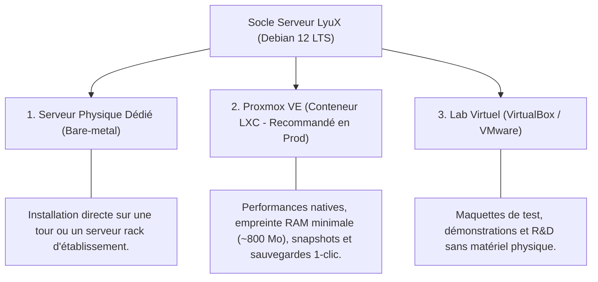

# 🏛️ Architecture Serveur Unique (All-in-One)

> **Référence Issues GitHub** : [#11](https://github.com/Luux-Manchot/LyuX/issues/11), [#2](https://github.com/Luux-Manchot/LyuX/issues/2)  
> **Décisions d'Architecture** : ADR-001, ADR-004, ADR-010

---

## 1. Vision d'Ensemble : L'Élimination du Mille-Feuille Serveur

Dans de nombreux établissements scolaires, l'infrastructure est éclatée entre plusieurs machines physiques ou serveurs virtuels sous licence (un contrôleur de domaine Windows Server, un serveur de fichiers, un serveur d'inventaire, un serveur de supervision), ce qui engendre des coûts de licences récurrents et une complexité de gestion insoutenable.

**LyuX unifie l'intégralité des rôles sur une seule et unique machine Debian 12 LTS.**

```
┌─────────────────────────────────────────────────────────────────────────────┐
│                    SERVEUR CENTRAL UNIQUE LYUX (Debian 12)                  │
│                                (192.168.10.1)                               │
├─────────────────────────────────────────────────────────────────────────────┤
│                                                                             │
│  [COUCHES SYSTÈME NATIVES]                                                  │
│  ├── Samba-AD DC 4.x      : Contrôleur de Domaine (Kerberos SSO, LDAP)      │
│  ├── Partages Fichiers    : /homes (Quotas) & /classes (Distribution/Depot) │
│  └── Cockpit Project      : Console web d'administration système (:9090)    │
│                                                                             │
│  [ÉCOSYSTÈME APPLICATIF DOCKER COMPOSE]                                     │
│  ├── MariaDB 10.11        : Base de données relationnelle mutualisée        │
│  ├── GLPI 10.x            : Inventaire du matériel et gestion des pannes    │
│  ├── LDAP Account Manager : Création de classes et gestion des comptes (:8082)│
│  ├── Uptime Kuma          : Tableau de bord visuel de supervision (:3001)   │
│  ├── Apt-Cacher-NG        : Accélérateur local des mises à jour (:3142)     │
│  ├── LyuX Control API     : Micro-service d'enrôlement et passerelle (:8000)│
│  └── Traefik v3.1         : Reverse-Proxy avec sous-domaines virtuels *.lan │
│                                                                             │
└─────────────────────────────────────────────────────────────────────────────┘
```

---

## 2. Déploiement Agnostique de l'Infrastructure (Issue #11)

Le serveur LyuX ne force aucune technologie matérielle et s'adapte à l'environnement de chaque lycée :



---

## 3. Matrice des Ports & Briques Officielles (Issue #2)

Conformément à l'Issue #2, LyuX proscrit les interfaces d'administration « fait-maison » fragiles et s'appuie exclusivement sur les **standards open source éprouvés de l'industrie** :

| Brique Logicielle | Mode d'Exécution | Port Réseau | Rôle et Spécification |
| :--- | :---: | :---: | :--- |
| **Samba-AD DC 4.x** | Natif Debian | `389` (LDAP), `88` (Kerberos), `636` (LDAPS) | Remplace Windows Server : authentifie élèves et enseignants via Kerberos SSO et gère les annuaires d'utilisateurs. |
| **Samba CIFS** | Natif Debian | `445` (SMB) | Distribue les espaces de travail distants : `~/Espace_Personnel` et `~/Partages_Classes`. |
| **Cockpit** | Natif Debian | `9090` (HTTPS) | Point d'entrée unique officiel pour la maintenance système (CPU, RAM, stockage, disques, mises à jour, logs). |
| **MariaDB 10.11** | Docker | `3306` (Interne) | Moteur SQL optimisé pour héberger les bases de GLPI et des outils scolaires. |
| **GLPI 10.x** | Docker | `8085` (HTTP) | Inventaire automatique du parc d'ordinateurs et gestion des tickets d'incidents / pannes en salle. |
| **LAM (LDAP Mgr)** | Docker | `8082` (HTTP) | Interface graphique sobre pour gérer les comptes : import CSV, réinitialisation de mots de passe, création de groupes de classe. |
| **Uptime Kuma** | Docker | `3001` (HTTP) | Supervision visuelle des salles : ping en direct de chaque PC, alertes en cas de panne réseau. |
| **Apt-Cacher-NG** | Docker | `3142` (HTTP) | Cache local des paquets : permet à 50 PC d'effectuer leurs mises à jour en 2 secondes sans saturer la fibre du lycée. |
| **LyuX API Hub** | Docker | `8000` (HTTP) | Micro-service FastAPI pour l'enrôlement automatique des nouveaux PC et le service du fichier preseed. |
| **Traefik v3.1** | Docker | `8088` / `8888` | Reverse-proxy routant automatiquement vers `glpi.lyux.lan`, `lam.lyux.lan`, `supervision.lyux.lan`. |

---

## 4. Spécifications Matérielles Requises

| Ressource | Minimum Fonctionnel (Lab / Test) | Recommandé Production (Lycée 1000 élèves) |
| :--- | :---: | :---: |
| **Processeur (CPU)** | 2 vCPUs | 4 cœurs (Intel Core i5/i7 ou Xeon récent) |
| **Mémoire Vive (RAM)** | 4 Go | 8 Go à 16 Go |
| **Stockage (Disque)** | 40 Go SSD | 500 Go à 1 To SSD NVMe (pour le stockage des devoirs) |
| **Interface Réseau** | 1 carte 100 Mb/s | 1 à 2 interfaces Gigabit Ethernet (1 Gb/s) |
