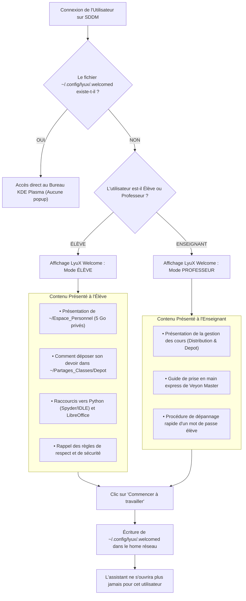

# 👋 Assistant Premier Démarrage (LyuX Welcome)

> **Référence Issue GitHub** : [#10](https://github.com/Luux-Manchot/LyuX/issues/10)

---

## 1. Contexte : L'Accueil d'un Nouvel Utilisateur

Lorsqu'un élève de Seconde ou un nouvel enseignant s'assoit pour la première fois devant un poste LyuX, il a besoin de repères simples et clairs pour comprendre :
* Où sont rangés ses fichiers personnels et ses devoirs.
* Comment fonctionne le partage de cours pour rendre un travail.
* Quels sont les raccourcis vers ses outils scolaires (Python, LibreOffice, ENT).
* Quelles sont les règles de la charte informatique de l'établissement.

Cet accueil ne doit être **ni intrusif, ni lourd, ni récurrent** : il ne doit apparaître qu'au tout premier démarrage et s'adapter automatiquement au profil de l'utilisateur.

---

## 2. Déroulement Logique & Détection du Premier Login

---

## 3. Persistance et Itinérance dans le Home Réseau

Puisque le répertoire personnel de l'utilisateur (`~`) est monté depuis le serveur central via `pam_mount` :
* Le fichier marqueur `.welcomed` est écrit directement sur le serveur distant (`//serveur/homes/<login>/.config/lyux/.welcomed`).
* **Conséquence directe :** Si l'élève change de salle ou de PC le lendemain (par exemple en passant de la salle B204 à la salle S102), le système vérifie le fichier sur le réseau et **n'affiche plus l'assistant**, lui offrant un accès instantané à son bureau de travail en 2 secondes.
