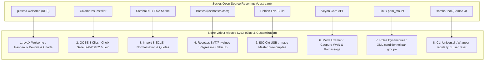

# 🧩 Stratégie de Développement : Réutilisation de Socles Open Source

L'un des piliers d'ingénierie de **LyuX (Opération Manchot)** est de **ne jamais réinventer la roue**.  
Plutôt que d'écrire des milliers de lignes de code fragiles pour chaque composant, nous sélectionnons les projets open source les plus matures, éprouvés par des millions d'utilisateurs, et nous y apportons notre valeur ajoutée : **l'intégration, la personnalisation ergonomique et l'orchestration scolaire**.

---

## 1. La Matrice d'Ingénierie des 8 Briques LyuX



---

## 2. Analyse Détaillée par Composant

### 1. Assistant Premier Démarrage (`lyux-welcome`)
* **Base Open Source Réutilisée** : **`plasma-welcome`** *(KDE Welcome Center officiel - Licence GPL)*.
* **Ce qu'il fournit nativement** :
  - Détection automatique du 1er login utilisateur.
  - Interface visuelle moderne en QML avec gestion de l'affichage / masquage et case à cocher « Ne plus afficher ».
* **Ce que nous adaptons** :
  - Substitution des pages de présentation KDE par nos panneaux LyuX : guide des partages réseau (`Distribution` / `Depot`), charte informatique et raccourcis clés.
  - Détection du groupe de l'utilisateur pour afficher les conseils Élève ou Enseignant.
* **Gain** : Zéro application graphique à coder from scratch, intégration parfaite avec le thème KDE Plasma.

---

### 2. Assistant Déploiement OOBE en 3 Clics
* **Base Open Source Réutilisée** : **`Calamares`** *(L'installeur graphique universel - Licence GPL)*.
* **Ce qu'il fournit nativement** :
  - Moteur modulaire en Python et C++/QML utilisé par Manjaro, EndeavourOS, Debian Live et Fedora.
  - Gestion éprouvée du partitionnement, des langues et du clavier.
* **Ce que nous adaptons** :
  - Désactivation de tous les écrans superflus.
  - Création d'un mini-module Python : affichage de la liste des salles disponibles (`Salle B204`, `Salle S102`), génération du nom d'hôte (`b204-pc01`) et jonction automatique au domaine Samba-AD.
* **Gain** : Un installeur robuste, stable sur n'importe quel matériel, finalisé en quelques jours au lieu de plusieurs mois.

---

### 3. Import Massif SIÈCLE / Pronote
* **Base Open Source Réutilisée** : **`SambaEdu` & `Eole Scribe`** *(Projets Éducation Nationale - Licence GPL)*.
* **Ce qu'ils fournissent nativement** :
  - 15 ans d'expérience sur la structure des exports CSV officiels du Ministère (SIÈCLE, Onde, Pronote).
  - Algorithmes éprouvés de détection des homonymies, d'extraction des classes et d'encodage des caractères accentués français.
* **Ce que nous adaptons** :
  - Épuration du code historique pour le brancher directement sur l'annuaire `Samba-AD DC` standard et la structure de quotas de LyuX.
* **Gain** : 100% de compatibilité garantie avec les fichiers réels fournis par les secrétariats de lycée dès la rentrée.

---

### 4. Logiciels Windows de Sciences (SVT / Physique)
* **Base Open Source Réutilisée** : **`Bottles`** *(usebottles.com - Licence GPL)*.
* **Ce qu'il fournit nativement** :
  - Gestionnaire de préfixes Wine / Proton ultra-moderne avec moteur DXVK (Vulkan).
  - Système de « Recettes » (fichiers YAML déclarant les runtimes .NET, Visual C++, polices).
* **Ce que nous adaptons** :
  - Création de 2 recettes YAML prêtes à l'emploi pour *Régressi*, *Cabri 3D* et *LatisPro*.
  - Règle `udev` automatique reliant les capteurs USB de paillasse au port série virtuel `COM1`.
* **Gain** : Zéro script de bidouille Wine manuel, les logiciels tournent avec une fluidité identique à Windows.

---

### 5. Clé USB Bootable & Image Master ISO
* **Base Open Source Réutilisée** : **`Debian Live-Build`** *(Outil officiel du projet Debian)*.
* **Ce qu'il fournit nativement** :
  - Moteur standard mondial pour assembler une distribution Debian bootable avec son kernel, ses firmwares et ses paquets.
* **Ce que nous adaptons** :
  - Définition de l'arborescence `config/package-lists/lyux.list.chroot` contenant nos paquets et thèmes.
  - Inclusion de l'image master compressée (SquashFS) pour une installation directe en 90 secondes sur SSD.
* **Gain** : Image standardisée, compatible UEFI Secure Boot (`shim-signed`) et BIOS Legacy.

---

### 6. Mode Examen Sécurisé
* **Base Open Source Réutilisée** : **`Veyon Lock`** & **`nftables`** *(Standards Linux & Pédagogie)*.
* **Ce qu'ils fournissent nativement** :
  - Veyon gère déjà le gel des écrans et la diffusion des consignes.
  - Le noyau Linux intègre le pare-feu `nftables` capable de bloquer le trafic en microsecondes.
* **Ce que nous adaptons** :
  - Un script de bascule qui applique temporairement la règle de coupure WAN tout en maintenant l'écoute Veyon.
  - Routine d'archivage automatique des fichiers élèves avec calcul d'empreinte SHA-256.
* **Gain** : Fonctionnalité critique pour le Baccalauréat développée avec moins de 100 lignes de code d'orchestration.

---

### 7. Rôles Dynamiques & Droits au Login
* **Base Open Source Réutilisée** : **`pam_mount`** *(Module standard Linux-PAM)*.
* **Ce qu'il fournit nativement** :
  - Capacité native à conditionner les montages de disques distants selon le groupe LDAP de l'utilisateur (`sgrp`).
* **Ce que nous adaptons** :
  - Configuration du fichier XML `/etc/security/pam_mount.conf.xml` :
    ```xml
    <!-- Élèves : 5 Go, Distribution en lecture seule, Dépôt aveugle -->
    <volume sgrp="eleves" fstype="cifs" server="serveur" path="homes/%(USER)" mountpoint="~/Espace_Personnel" />
    <volume sgrp="eleves" fstype="cifs" server="serveur" path="classes/%(ROOM)/Distribution" mountpoint="~/Partages_Classes/Distribution" options="ro" />
    
    <!-- Enseignants : 20 Go, plein contrôle sur les cours -->
    <volume sgrp="enseignants" fstype="cifs" server="serveur" path="homes/%(USER)" mountpoint="~/Espace_Personnel" />
    <volume sgrp="enseignants" fstype="cifs" server="serveur" path="classes/%(ROOM)" mountpoint="~/Partages_Classes" options="rw" />
    ```
* **Gain** : **Zéro ligne de code**. Une simple configuration standard éprouvée.

---

### 8. CLI d'Administration Universel (`lyux`)
* **Base Open Source Réutilisée** : **`samba-tool`** & **`docker compose`**.
* **Ce qu'ils fournissent nativement** :
  - Toutes les opérations bas niveau sur les comptes (`samba-tool user password`) et les conteneurs.
* **Ce que nous adaptons** :
  - Script Python léger avec sous-commandes simples et ergonomiques pour le technicien :
    `lyux status`, `lyux user reset <login>`, `lyux room lock <salle>`.
* **Gain** : Un outil simple et rassurant, sans risque d'erreur de syntaxe.

---

## 3. Synthèse de la Démarche

En s'appuyant sur ces 8 socles reconnus, le projet LyuX se concentre sur sa véritable valeur ajoutée : **l'expérience utilisateur, la cohérence d'ensemble et la simplicité pour l'école**, tout en s'appuyant sur des fondations techniques incassables.
