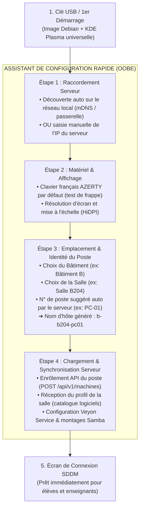

# 💿 Déploiement Clé USB & OOBE Piloté par le Serveur

> **Référence Issues GitHub** : [#1](https://github.com/Luux-Manchot/LyuX/issues/1), [#4](https://github.com/Luux-Manchot/LyuX/issues/4), [#13](https://github.com/Luux-Manchot/LyuX/issues/13)  
> **Décisions d'Architecture** : ADR-005

---

## 1. La Philosophie : Client Universel Léger & Serveur Maître

Dans LyuX, **on ne choisit aucune application à pré-installer lors de l'installation du client** :
1. **Une image ISO universelle unique** : Le système déployé sur clé bootable est minimal, léger et strictement identique sur tous les ordinateurs du lycée (Debian GNU/Linux + socle KDE Plasma + SDDM + Agent LyuX).
2. **Le Serveur décide de tout** : C'est le serveur central qui, une fois le poste raccordé et identifié par sa localisation (bâtiment, salle, numéro de poste), lui transmet sa configuration logicielle (Flatpak/conteneurs), ses droits de supervision Veyon et ses partages réseau.

---

## 2. Déroulé Chronologique de la Configuration Rapide (OOBE)

Au premier allumage du poste (ou directement depuis la clé bootable), un assistant graphique plein écran s'exécute automatiquement :

---

## 3. Détail des Écrans de l'Assistant

| Étape | Ce que voit l'installateur / technicien | Actions automatiques du système |
| :--- | :--- | :--- |
| **1. Connexion Serveur** | • Statut : *"Recherche du serveur LyuX..."* • Si trouvé : badge vert avec bouton *"Valider"*. • Champ alternatif pour taper l'IP si réseau filtré. | Écoute mDNS (`_lyux._tcp.local`) et requête de présence sur la passerelle. |
| **2. Clavier & Écran** | • Disposition clavier AZERTY française pré-sélectionnée. • Réglage de la résolution et de l'échelle d'affichage (100 %, 125 %, 150 %). | Application instantanée de la géométrie Wayland/X11 et de la table de caractères. |
| **3. Bâtiment, Salle & N° PC** | • Sélection du **Bâtiment** (ex: *Bâtiment B*). • Choix de la **Salle** (ex: *Salle B204*). • **Numéro de poste** : proposé automatiquement par le serveur (prochain numéro libre dans la salle). | Construction du nom d'hôte (`b-b204-pc03.lyux.lan`) et binding avec l'adresse MAC. |
| **4. Chargement & Synchronisation** | • Écran d'attente avec barre de progression animée : *"Synchronisation avec le serveur central..."* | • Enregistrement dans l'annuaire (`POST /api/v1/machines`). • Réception de la liste des applications assignées à la classe (ex: Thonny/Python pour B204, Tracker/Avogadro pour les sciences, LibreOffice partout). • Déclaration auprès du service de supervision Veyon de la salle. |
| **5. Terminé** | Clôture de l'assistant de configuration. | Affichage direct de l'écran de connexion **SDDM / KDE Plasma**. |

---

## 4. Spécifications pour la Clé USB Bootable (`lyux-iso-builder`)

- **Format de l'image** : ISO hybride (UEFI + BIOS Legacy) flashable via Ventoy, Rufus ou BalenaEtcher.
- **Type de déploiement** : Image master compressée (SquashFS). Déploiement en 1 à 2 minutes chrono sur le SSD sans téléchargement internet pendant l'écriture.
- **Verrou d'enrôlement** : Une fois la configuration terminée, un fichier témoin `/etc/lyux/enrolled.lock` garantit que l'assistant OOBE ne se réaffichera plus aux démarrages suivants.
