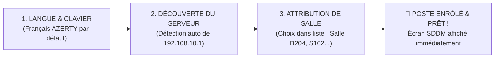

# 💿 Déploiement Clé USB & OOBE "Style Windows Setup"

> **Référence Issues GitHub** : [#1](https://github.com/Luux-Manchot/LyuX/issues/1), [#4](https://github.com/Luux-Manchot/LyuX/issues/4)  
> **Décisions d'Architecture** : ADR-005

---

## 1. La Problématique : L'Élimination des Écrans Bleus Textuels (Issue #1)

L'installation classique de Debian Netinst affichait des fenêtres textuelles bleues réclamant des fichiers debconf, des adresses IP ou des miroirs corrompus. Cette expérience est incompatible avec le déploiement rapide d'un parc informatique scolaire.

**LyuX adopte une approche moderne et visuelle inspirée de l'ergonomie de Windows Setup :**
1. **Zéro invite textuelle d'installeur.**
2. **Choix graphique de l'édition** sur clé bootable.
3. **Déploiement direct de l'image master en 1 à 2 minutes.**
4. **Assistant OOBE (Out-Of-Box-Experience) en 3 clics** au premier allumage du PC.

---

## 2. Le Menu de Sélection Graphique (Clé Bootable Universelle)

L'administrateur ou le technicien démarre le PC sur la clé USB LyuX et accède à un menu graphique clair :

```
┌────────────────────────────────────────────────────────────────────────┐
│                   INSTALLATEUR UNIVERSEL LYUX (OPÉRATION MANCHOT)       │
├────────────────────────────────────────────────────────────────────────┤
│                                                                        │
│   Choisissez le profil d'installation pour cet ordinateur :            │
│                                                                        │
│   [1] 🖥️ POSTE LYCÉE UNIVERSEL (Standard Salles & Postes)             │
│       KDE Plasma sous X11, AZERTY, Veyon, LibreOffice, Python, Kiosk   │
│                                                                        │
│   [2] 🔬 POSTE LABORATOIRE SCIENCES (Salles TP Physique/SVT)           │
│       Profil standard + Outils de modélisation, capteurs & tableurs    │
│                                                                        │
│   [3] 📚 POSTE CONSULTATION LIBRE (CDI & Espaces Ouverts)              │
│       Kiosk renforcé, session invité éphémère, marque-pages documentaires│
│                                                                        │
│   [4] 🏛️ SERVEUR CENTRAL LYUX TOUT-EN-UN (Infrastructure)              │
│       Debian 12 Server, Samba-AD DC, Docker Compose, Cockpit, GLPI     │
│                                                                        │
│   ───────────────────────────────────────────────────────────────────  │
│   [ Continuer l'installation en 1 clic ]            [ Quitter ]        │
└────────────────────────────────────────────────────────────────────────┘
```

---

## 3. L'Assistant OOBE au Premier Démarrage (3 Clics)

Dès la fin de l'écriture de l'image (environ 90 secondes sur un SSD NVMe), l'ordinateur redémarre et affiche l'assistant d'intégration express :



1. **Clic 1 — Langue & Clavier** : Français AZERTY (`fr-latin9`) est pré-sélectionné.
2. **Clic 2 — Découverte Serveur** : Le poste diffuse une requête locale pour trouver le serveur central LyuX (ou saisie de l'IP `192.168.10.1`).
3. **Clic 3 — Attribution de Salle** : Le technicien clique sur le nom de la salle (ex: `Salle B204`). Le PC s'enregistre automatiquement dans l'annuaire avec son nom de poste (`b204-pc01.lyux.lan`).
4. **Terminer** : L'écran de connexion **SDDM** apparaît. Le poste est opérationnel pour les élèves et les enseignants sans aucun redémarrage supplémentaire.
