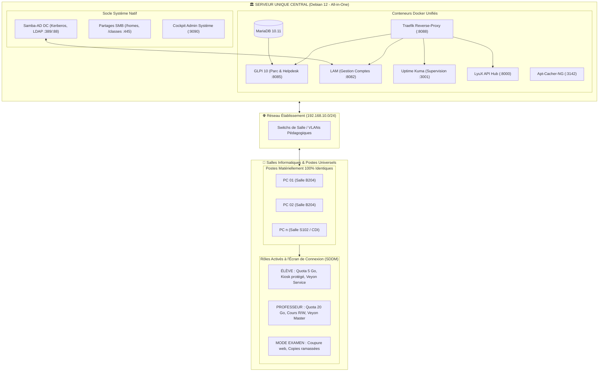

# 🐧 Wiki Officiel — Projet LyuX (Opération Manchot)

Bienvenue sur le Wiki technique, fonctionnel et architectural du projet **LyuX (Opération Manchot)**.  
LyuX est le système d'exploitation et d'infrastructure libre conçu sur mesure pour moderniser, sécuriser et unifier l'environnement numérique des lycées et collèges.

---

## 🗺️ Schéma Fonctionnel Global

---

## 🧭 Sommaire Général du Wiki

| Section | Document | Description & Problématique Couverte |
| :--- | :--- | :--- |
| **01. Infrastructure** | **[Architecture Serveur Unique](Architecture-Serveur-Unique)** | Serveur Debian 12 All-in-One (Samba-AD, Docker, MariaDB, GLPI, LAM, Cockpit). *(Issue #11, Issue #2)* |
| **02. Postes & Rôles** | **[Postes Universels & Itinérance](Postes-Universels-et-Itinerance)** | Zéro PC dédié, itinérance totale `pam_mount`, droits stricts profs/élèves. *(Issue #3)* |
| **03. Supervision** | **[Supervision Veyon Master](Supervision-Veyon-Master)** | Activation dynamique de Veyon Master au login prof, clés RSA asymétriques. *(Issue #9)* |
| **04. Pédagogie** | **[Mode Examen Sécurisé](Mode-Examen-Securise)** | Isolation réseau, blocage internet et ramassage automatique des copies. *(Issue #6)* |
| **05. Annuaire Scolaire** | **[Import Massif SIÈCLE & Pronote](Import-Massif-SIECLE-Pronote)** | Intégration automatisée des exports CSV officiels de l'Éducation Nationale. *(Issue #5)* |
| **06. Logiciels** | **[Catalogue de Logiciels Flatpak](Catalogue-Logiciels-Flatpak)** | Distribution Flathub sans Snap, droits d'installation par profil. *(Issue #7)* |
| **07. Expérience Utilisateur** | **[Assistant Premier Démarrage (Welcome)](Assistant-Premier-Demarrage-Welcome)** | Guide sobre au 1er login pour présenter les partages et la charte. *(Issue #10)* |
| **08. Déploiement** | **[Déploiement Clé USB & OOBE](Deploiement-Cle-USB-OOBE)** | Installation graphique style Windows Setup en 3 clics sans écran bleu textuel. *(Issue #1, Issue #4)* |
| **09. Tests & Validation** | **[Lab Virtuel & Automatisation SSH](Lab-Virtuel-et-Automatisation-SSH)** | Environnement de test en petites VMs pilotées à 100% en SSH, 264 tests E2E. *(Issue #8)* |
| **10. Compatibilité Windows** | **[Logiciels Windows (Wine/Proton)](Compatibilite-Logiciels-Windows-Wine-Proton)** | Exécution transparente des logiciels historiques de SVT / Physique / Maths via Wine & Proton. |
| **11. Stratégie de Dev** | **[Socles Open Source & Dev](Bases-Open-Source-et-Strategie-de-Dev)** | Réutilisation et personnalisation des socles majeurs (Calamares, plasma-welcome, SambaEdu, Bottles). |

---

## 🎯 Suivi d'Avancement des Issues GitHub

| # | Thématique | Intitulé de l'Issue | Statut Architectural | Solution Documentée |
| :-: | :--- | :--- | :---: | :--- |
| **#1** | Boot / Client | Élimination définitive du Debian-Installer textuel | **Résolu** | [Déploiement Clé USB & OOBE](Deploiement-Cle-USB-OOBE) |
| **#2** | Infra / Admin | Suppression des interfaces fait-maison (Cockpit, LAM, GLPI) | **Résolu** | [Architecture Serveur Unique](Architecture-Serveur-Unique) |
| **#3** | Client / Session | Postes 100% universels : Itinérance totale | **Résolu** | [Postes Universels & Itinérance](Postes-Universels-et-Itinerance) |
| **#4** | Déploiement | Clé USB bootable universelle (Choix édition & OOBE) | **Résolu** | [Déploiement Clé USB & OOBE](Deploiement-Cle-USB-OOBE) |
| **#5** | Données Élèves | Import massif des élèves/profs depuis SIÈCLE / Pronote | **Spécifié** | [Import Massif SIÈCLE & Pronote](Import-Massif-SIECLE-Pronote) |
| **#6** | Pédagogie | Mode Examen sécurisé (Isolation et ramassage) | **Spécifié** | [Mode Examen Sécurisé](Mode-Examen-Securise) |
| **#7** | Applications | Distribution Flatpak & droits par profil | **Spécifié** | [Catalogue de Logiciels Flatpak](Catalogue-Logiciels-Flatpak) |
| **#8** | Lab Virtuel | 1 Serveur + 2 Postes sur réseau isolé VirtualBox | **Validé** | [Lab Virtuel & Automatisation SSH](Lab-Virtuel-et-Automatisation-SSH) |
| **#9** | Supervision | Activation dynamique de Veyon Master au login prof | **Validé** | [Supervision Veyon Master](Supervision-Veyon-Master) |
| **#10**| UX / Session | Assistant Premier Démarrage (LyuX Welcome) | **Validé** | [Assistant Premier Démarrage (Welcome)](Assistant-Premier-Demarrage-Welcome) |
| **#11**| Infra Serveur | Socle serveur agnostique (Proxmox, Bare-Metal, VM) | **Résolu** | [Architecture Serveur Unique](Architecture-Serveur-Unique) |
| **#12**| Stratégie Dev | Réutilisation de socles open source éprouvés | **Résolu** | [Socles Open Source & Dev](Bases-Open-Source-et-Strategie-de-Dev) |
| **#13**| OOBE / Boot | Client Léger Universel piloté par le Serveur | **Spécifié** | [Déploiement Clé USB & OOBE](Deploiement-Cle-USB-OOBE) |
| **#14**| Stockage | Système de Cache Profils Hybride LRU | **Spécifié** | [Feuille de Route](Roadmap) |
| **#15**| UX / Sécurité | Ergonomie Dolphin & Masquage Disque sda1 | **Spécifié** | [Postes Universels & Itinérance](Postes-Universels-et-Itinerance) |

---

## 🏛️ Les Dépôts Officiels de l'Organisation GitHub Luux-Manchot

L'écosystème LyuX est découpé en dépôts spécialisés sous l'organisation officielle [`github.com/Luux-Manchot`](https://github.com/Luux-Manchot) :

| Dépôt GitHub | Rôle & Composants | Cible de Déploiement |
| :--- | :--- | :--- |
| **[`Luux-Manchot/LyuX`](https://github.com/Luux-Manchot/LyuX)** | Dépôt principal, documentation globale, wiki, suivi de la roadmap | Organisation & Architecture |
| **[`Luux-Manchot/lyux-server`](https://github.com/Luux-Manchot/lyux-server)** | API centrale FastAPI, pile Docker (Samba-AD, GLPI, Traefik, Cockpit) | Serveur Dédié / Proxmox |
| **[`Luux-Manchot/lyux-desktop`](https://github.com/Luux-Manchot/lyux-desktop)** | Environnement KDE Plasma, SDDM épuré, OOBE, Veyon, Agent de synchro | Postes de Salle & Clients |
| **[`Luux-Manchot/lyux-os-builder`](https://github.com/Luux-Manchot/lyux-os-builder)** | Outil de création d'ISO bootable universelle, SquashFS, Calamares | Clés USB d'installation |
| **[`Luux-Manchot/lyux-import-siecle`](https://github.com/Luux-Manchot/lyux-import-siecle)** | Outil CLI autonome d'importation des exports SIÈCLE & Pronote CSV | Outil d'administration |

---

Projet conçu et développé par **FlowCreativeStudio** · Florian ([@NayrolfRdgs](https://github.com/NayrolfRdgs))  
Contact officiel : `contact@flowcrea.fr`  
*Opération Manchot — Système d'exploitation & infrastructure libre pour lycées et collèges.*

