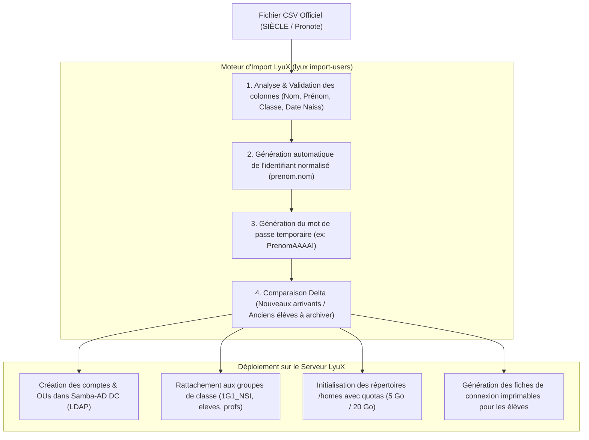

# 👥 Import Massif SIÈCLE & Pronote

> **Référence Issue GitHub** : [#5](https://github.com/Luux-Manchot/LyuX/issues/5)

---

## 1. Le Besoin Scolaire en Début d'Année

À chaque rentrée de septembre, le référent numérique ou l'administrateur système d'un lycée doit créer **plusieurs centaines ou milliers de comptes** élèves et enseignants.  
Faire cette opération manuellement est chronophage et source d'erreurs.

LyuX intègre un moteur de traitement direct des fichiers d'export officiels du Ministère de l'Éducation Nationale :
* **SIÈCLE** (Système d'Information pour les Élèves des Collèges et des Lycées).
* **Onde** (pour les écoles).
* **Pronote / Index Éducation** (Exports CSV standards des élèves et professeurs).

---

## 2. Cycle de Traitement Automatisé



---

## 3. Format CSV Supporté & Règles de Normalisation

### Exemple de fichier d'import CSV SIÈCLE / Pronote
```csv
Nom,Prénom,Classe,Date_Naissance,Rôle
Martin,Lucas,1G1,14/05/2009,eleve
Bernard,Emma,1G1,22/11/2009,eleve
Durand,Thomas,Prof_NSI,,enseignant
```

### Règles de Normalisation Appliquées
1. **Identifiant (`sAMAccountName`)** :  
   - Format standard : `prenom.nom` (en minuscules, caractères accentués nettoyés, ex: `lucas.martin`, `emma.bernard`).
   - En cas d'homonymie : suffixage automatique `prenom.nom2`.
2. **Mot de passe initial temporaire** :  
   - Format sécurisé et mémorisable pour l'élève : `PrenomAAAA!` (ex: `Lucas2009!`).
   - Flag Kerberos `pwdLastSet=0` activé : l'élève est invité à choisir son propre mot de passe personnel dès sa toute première connexion sur le poste.
3. **Arborescence LDAP / Active Directory générée** :
   ```
   DC=lyux,DC=lan
   ├── OU=Utilisateurs
   │   ├── OU=Eleves
   │   │   ├── OU=1G1 (lucas.martin, emma.bernard)
   │   │   └── OU=1G2
   │   └── OU=Enseignants (thomas.durand)
   └── OU=Groupes
       ├── CN=eleves
       ├── CN=enseignants
       └── CN=classe_1g1
   ```

---

## 4. Gestion des Départs et Arrivées en Cours d'Année (Mode Delta)

En cours d'année scolaire, des élèves changent de classe ou d'établissement.  
Le moteur d'import compare le nouveau fichier CSV avec l'état actuel de l'annuaire Samba-AD :
* **Nouvel élève détecté** : Compte et espace personnel créés en quelques secondes.
* **Élève absent du nouvel export (départ)** : Le compte n'est pas brutalement supprimé : il est **désactivé et déplacé dans l'OU `Archives`** pendant une période de rétention de 6 mois pour permettre la récupération de travaux éventuels.
