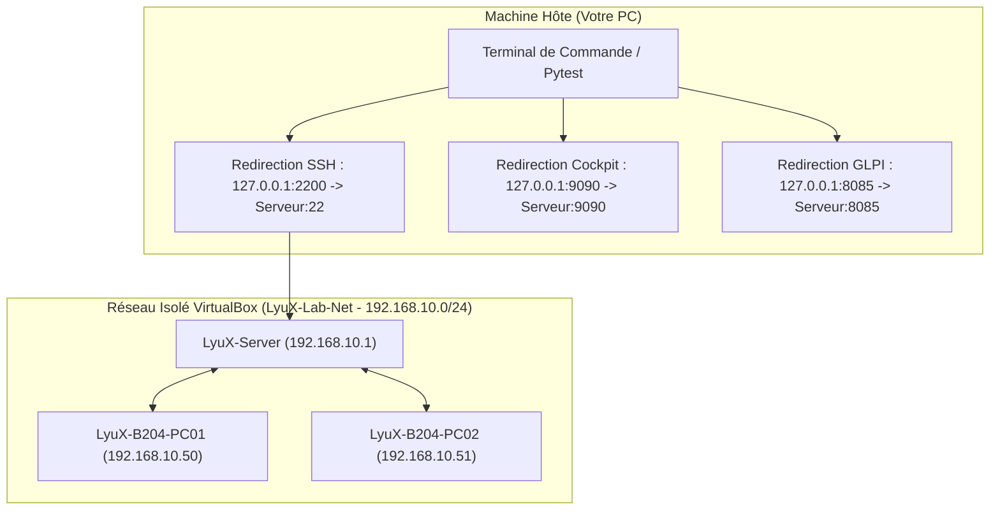

# 🧪 Lab Virtuel & Automatisation SSH

> **Référence Issue GitHub** : [#8](https://github.com/Luux-Manchot/LyuX/issues/8)

---

## 1. Objectif du Lab Virtuel

Pour tester l'ensemble de l'architecture LyuX sans disposer de 30 PC physiques ni perturber le réseau domestique ou de l'établissement :
* Création d'un **réseau interne VirtualBox isolé** nommé `LyuX-Lab-Net` (`192.168.10.0/24`).
* **1 VM Serveur Central** (`LyuX-Server`).
* **2 VMs Postes Universels** (`LyuX-B204-PC01`, `LyuX-B204-PC02`).
* **Zéro clic manuel** : Toutes les machines sont provisionnées et testées à distance via **OpenSSH** et validées par la suite de tests automatisée **pytest**.

---

## 2. Topologie Réseau du Lab



---

## 3. Configuration des Machines Virtuelles

| Machine | CPU | RAM | Disque | Carte 1 (Réseau Isolé) | Carte 2 (Accès Hôte) |
| :--- | :---: | :---: | :---: | :--- | :--- |
| **`LyuX-Server`** | 2 vCPUs | 4096 Mo | 40 Go VDI | `intnet` (`LyuX-Lab-Net`, IP fixe `192.168.10.1`) | `nat` avec redirections (2200->22, 9090->9090, 8085->8085, 389->389, 4445->445) |
| **`LyuX-B204-PC01`** | 2 vCPUs | 2048 Mo | 20 Go VDI | `intnet` (`LyuX-Lab-Net`, DHCP `192.168.10.50`) | `nat` (téléchargements & SSH 2201->22) |
| **`LyuX-B204-PC02`** | 2 vCPUs | 2048 Mo | 20 Go VDI | `intnet` (`LyuX-Lab-Net`, DHCP `192.168.10.51`) | `nat` (téléchargements & SSH 2202->22) |

---

## 4. Automatisation SSH & Validation E2E

### Connexion directe sans mot de passe
Dès la création des machines, la clé SSH d'administration est injectée dans `/home/lyux-admin/.ssh/authorized_keys`.  
L'administrateur peut interagir directement avec n'importe quelle machine :

```powershell
# Connexion au serveur central
ssh -p 2200 lyux-admin@127.0.0.1

# Connexion au poste élève 01
ssh -p 2201 lyux-admin@127.0.0.1
```

### Exécution de la Suite de Tests d'Intégration
Le projet dispose d'une suite de **264 tests d'intégration automatisés** vérifiant :
1. L'écoute des ports Samba (389, 88, 445) et Cockpit (9090).
2. L'étanchéité des partages de cours (l'élève ne peut pas effacer la copie d'un autre élève).
3. L'application stricte des quotas (5 Go pour l'élève, 20 Go pour l'enseignant).
4. Le démarrage de Veyon Master uniquement pour le profil enseignant.

```powershell
# Exécution des tests automatisés
python -m pytest tests/e2e tests/test_lyux_core.py -v
```
Résultat attendu : **`264 passed in 0.97s (100% PASS)`**.
