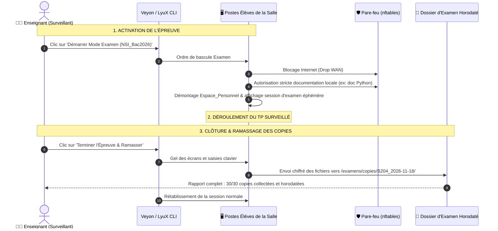

# 🛡️ Mode Examen Sécurisé & Ramassage Automatique

> **Référence Issue GitHub** : [#6](https://github.com/Luux-Manchot/LyuX/issues/6)

---

## 1. Contexte Pédagogique : Les Épreuves Pratiques au Lycée

Lors des épreuves pratiques officielles (ex: **Épreuve Pratique de NSI**, Travaux Pratiques de Physique-Chimie, Baccalauréat, devoirs surveillés), l'établissement doit garantir l'équité et la régularité de l'examen :
* **Aucun accès à Internet** (moteurs de recherche, messageries, IA en ligne).
* **Aucun accès aux cours précédents** stockés dans `~/Espace_Personnel` ou `~/Partages_Classes`.
* **Blocage des supports amovibles** (clés USB non autorisées).
* **Ramassage automatisé et infalsifiable** des copies numériques à la fin du temps imparti.

---

## 2. Fonctionnement du Mode Examen en 3 Étapes

---

## 3. Spécifications Techniques des Restrictions

### A. Filtrage Réseau Strict (nftables / iptables)
Pendant toute la durée de l'examen, le pare-feu applique les règles suivantes :
* **Trafic WAN (Internet)** : `DROP` systématique (ports 80, 443 bloqués vers l'extérieur).
* **Trafic Local Autorisé (Liste blanche)** :
  - `192.168.10.1:11100-11400` : Veyon (supervision active pour l'enseignant).
  - `192.168.10.1:8080` (Optionnel) : Serveur de documentation locale hors-ligne (ex: documentation officielle Python, Pygame, fiches ressources PDF).
* **Partages Standards Masqués** : Les partages Samba habituels sont inaccessibles afin d'éviter la consultation de cours pré-enregistrés.

### B. Espace de Travail Éphémère
* L'élève travaille dans un répertoire local dédié : `/tmp/examen_<id_epreuve>/`.
* Les clés USB personnelles sont automatiquement montées en lecture seule ou neutralisées selon la directive de l'épreuve.

### C. Ramassage et Archivage des Copies
À la seconde où le professeur clique sur **"Ramasser les copies"** :
1. Le clavier et la souris de chaque élève sont immédiatement verrouillés avec le message :  
   `"Épreuve terminée. Veuillez ne plus toucher à votre poste. Copies en cours de ramassage..."`.
2. Les scripts d'enrôlement compressent le dossier de travail de l'élève en une archive nommée :  
   `Copie_<Nom>_<Prenom>_<Poste>_<Horodatage>.tar.gz` avec son empreinte SHA-256.
3. Les archives sont téléversées directement dans le dossier d'examen du professeur.
4. L'enseignant dispose d'un rapport visuel immédiat confirmant la bonne réception des 30 copies.
