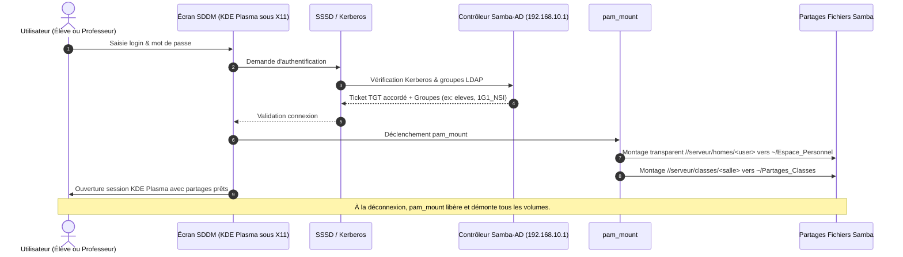

# 💻 Postes Universels & Itinérance Totale

> **Référence Issue GitHub** : [#3](https://github.com/Luux-Manchot/LyuX/issues/3)  
> **Décisions d'Architecture** : ADR-002, ADR-003, ADR-007

---

## 1. Le Principe Fondateur : Zéro PC Dédié

Dans la réalité d'un lycée, les élèves et les enseignants changent continuellement de salle au fil de la journée.  
L'architecture LyuX pose une règle stricte :  
👉 **Tous les ordinateurs de toutes les salles sont matériellement et logiciellement 100% IDENTIQUES.**

Il n'existe aucun ordinateur « spécial professeur » ou « spécial élève ». N'importe quel PC peut devenir le poste du professeur ou celui d'un élève. **C'est l'authentification sur l'écran d'accueil (SDDM) qui active les rôles et les permissions.**

---

## 2. Comparatif Détaillé des Rôles au Login

| Critère | 👨‍🎓 Profil Élève (`lucas.martin`) | 👩‍🏫 Profil Enseignant (`thomas.durand`) | 🛠️ Profil Maintenance / Invité |
| :--- | :--- | :--- | :--- |
| **Authentification** | Groupe Samba-AD `eleves` | Groupe Samba-AD `enseignants` | Groupe local `sudo` ou compte `invite` |
| **Quota Espace Personnel** | **5 Go** (`~/Espace_Personnel`) | **20 Go** (`~/Espace_Personnel`) | Temporaire (effacé à la fermeture) |
| **Dossier `Distribution`** | **Lecture seule** (`0550`) | **Lecture & Écriture** (`0770`) | Aucun accès aux données de cours |
| **Dossier `Depot`** | **Boîte aveugle** (`1770`) — il dépose sans voir les devoirs des autres | **Lecture & Écriture** (`0770`) — il consulte et note tous les devoirs | Aucun accès |
| **Supervision de Salle** | Démon passif `Veyon Service` actif (:11100) | Interface **Veyon Master** ouverte avec vue sur les écrans élèves | Veyon désactivé |
| **Environnement Bureau** | KDE Plasma sous **Kiosk verrouillé** (panneaux et réglages protégés) | KDE Plasma complet avec outils pédagogiques | Session neutre |

---

## 3. Mécanisme Technique du Montage Transparent (`pam_mount`)

Aucune donnée utilisateur permanente n'est stockée sur le disque dur local du PC :



---

## 4. Arborescence des Partages de Classe

Dans chaque salle informatique (ex: Salle B204), le partage est structuré comme suit :

```
/classes/B204/
├── Distribution/       <-- Le prof y dépose les énoncés de TP.
│   │                       Élèves : Lecture seule (0550)
│   │                       Profs  : Écriture totale (0770)
│   ├── TP1_Python.pdf
│   └── Données_Exercice.csv
│
└── Depot/              <-- Les élèves y déposent leurs travaux.
    │                       Élèves : Dépôt aveugle (1770)
    │                       Profs  : Consultation et correction (0770)
    ├── Martin_Lucas_TP1.py
    └── Bernard_Emma_TP1.py
```

Grâce à ces permissions, les élèves ne peuvent ni supprimer les énoncés déposés par l'enseignant, ni copier les fichiers de leurs camarades déposés dans le répertoire `Depot`.
