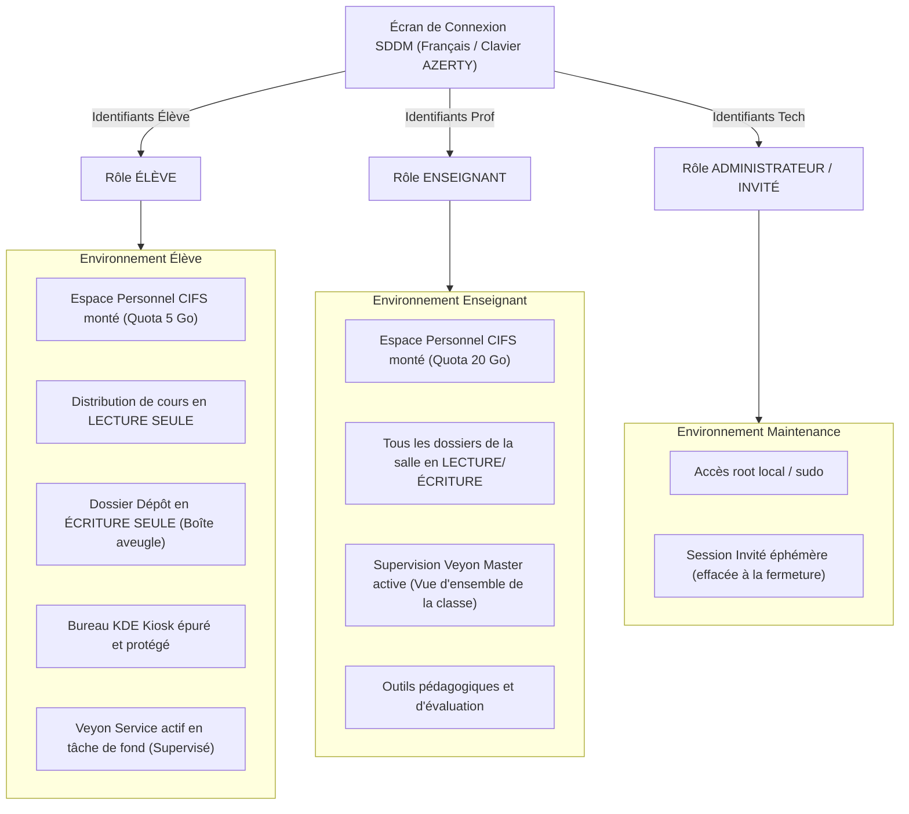

# 💻 Postes Universels & Rôles Dynamiques — LyuX

L'un des principes directeurs de LyuX est la **disparition de la distinction matérielle** entre les postes informatiques d'une salle de classe.

---

## 1. Le Principe : Zéro PC "Prof" ou "Élève" en dur

Dans beaucoup d'établissements, un poste spécifique est réservé à l'enseignant (parfois verrouillé ou physiquement différent). Si ce poste tombe en panne, le cours est perturbé.

Dans l'architecture LyuX :
* **Tous les ordinateurs d'une salle sont 100% identiques** (même image, même disque, même configuration matérielle).
* **N'importe quel poste peut devenir le poste de l'enseignant ou celui d'un élève.**
* **C'est l'authentification sur l'écran d'accueil (SDDM) qui active le rôle et applique les droits.**

---

## 2. Comparatif des Rôles Activés au Login

---

## 3. Détail des Mécanismes Techniques

### A. Montage Transparent par `pam_mount`
Aucun profil utilisateur permanent n'est stocké en local sur le PC. À la saisie des identifiants :
1. `pam_mount` contacte le contrôleur Samba-AD (`LYUX.LAN`) via Kerberos/LDAP.
2. Le partage distant `//serveur/homes/<login>` est monté à la volée dans `~/Espace_Personnel`.
3. Le partage de classe `//serveur/classes/<salle>` est monté dans `~/Partages_Classes` avec les permissions strictes selon le groupe :
   - Groupe `eleves` :
     - `Distribution` : lecture seule (`0550`).
     - `Depot` : écriture sans visibilité sur les copies des autres (`1770` sticky bit ou permissions CIFS aveugles).
   - Groupe `enseignants` :
     - `Distribution` et `Depot` en contrôle total (`0770`).
4. À la fermeture de session, les partages sont proprement démontés.

### B. Supervision Pédagogique Veyon Sécurisée (Asymétrique)
* **Sur le poste d'un élève** : Seul le démon d'écoute `Veyon Service` (`port 11100`) tourne. Il possède uniquement la clé publique RSA de l'établissement (`0444`). L'élève ne peut jamais commander ou espionner un autre poste.
* **Sur le poste du professeur** : La session détecte l'appartenance au groupe `enseignants`, active la clé privée RSA (`0440`) et démarre `Veyon Master`. L'enseignant voit alors en direct les vignettes de tous les écrans des élèves de la salle, peut verrouiller les écrans, faire une démonstration en direct ou envoyer un fichier en 1 clic.

### C. Premier Démarrage Guidé (`lyux-welcome`)
Au tout premier login d'un nouvel utilisateur sur un poste, l'assistant sobre **LyuX Welcome** s'ouvre pour présenter l'arborescence des dossiers devoirs, les raccourcis clés et la charte informatique de l'établissement, avec la case à cocher "Ne plus afficher".
