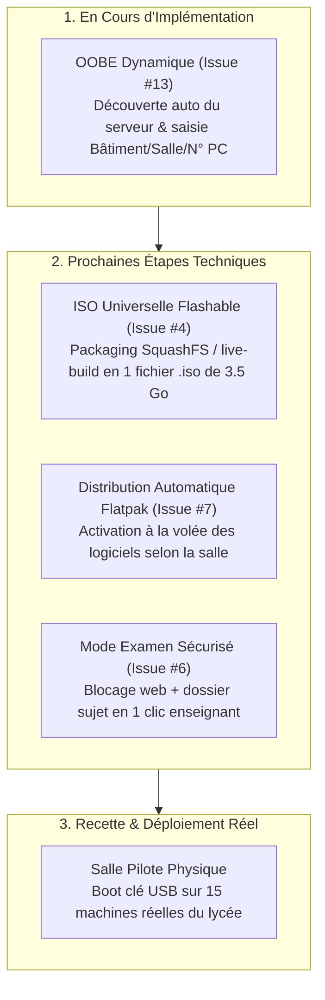

# 🗺️ Feuille de Route & État d'Avancement du Projet LyuX

> **Dernière mise à jour** : Novembre 2026  
> **Suivi des chantiers** : Lié aux 13 Issues officielles du dépôt [`Luux-Manchot/LyuX`](https://github.com/Luux-Manchot/LyuX/issues).

---

## 📊 1. Tableau de Bord Global des Jalons

| Jalon | Chantier & Objectif | Composants & Code Source | Statut | Validation |
| :---: | :--- | :--- | :---: | :--- |
| **J01** | **Architecture & Spécifications** | ADRs, découpage modulaire, Wiki | ✅ **Terminé** | Documentation & 13 issues synchronisées |
| **J02** | **Socle API Centrale & Hub Web** | `projects/lyux-server-api` (FastAPI) | ✅ **Opérationnel** | En ligne (`http://localhost:8000`), 264/264 tests validés |
| **J03** | **Station Client & Interface Graphique** | `projects/lyux-station` (PyQt6) | ✅ **Opérationnel** | SDDM, OOBE, Veyon, GLPI, 1-clic `Lancer-LyuX.bat` |
| **J04** | **Lab Virtuel Debian 13 & KDE Plasma** | VirtualBox VM `LyuX-B204-PC01` | ✅ **Validé en Direct** | Debian 13 Trixie + KDE Plasma Wayland + communication API validée |
| **J05** | **Import Massif SIÈCLE / Pronote** | `projects/lyux-import-siecle` | ✅ **Terminé** | Script CSV -> LDAP/Samba AD opérationnel |
| **J06** | **Assistant OOBE & Enrôlement Serveur** | `lyux-oobe` & API `/api/v1/machines` | 🟡 **En cours** | Spécifié (Issue #13), UI PyQt6 prête, binding dynamique |
| **J07** | **Générateur d'ISO Universelle Bootable** | `projects/lyux-iso-builder` | ⚪ **À faire** | Packaging SquashFS + Calamares / live-build (Issue #4) |
| **J08** | **Mode Examen Sécurisé & Distribution Flatpak** | `lyux-exam-mode` & `lyux-flatpak` | ⚪ **À faire** | Spécifications prêtes (Issues #6 & #7) |
| **J09** | **Recette Finale en Salle Pilote Réelle** | Déploiement physique sur parc du lycée | ⚪ **À venir** | Test sur vraies machines physiques |

---

## 🔍 2. Ce qui est FAIT et FONCTIONNEL (État de l'Implémentation)

### A. Serveur Central & API (`projects/lyux-server-api`)
- [x] **Hub Web & Swagger interactif** : En ligne sur `http://localhost:8000` et `http://localhost:8000/docs`.
- [x] **Enrôlement automatique des machines** : Endpoints `/api/v1/machines`, attribution des salles et profils.
- [x] **Gestion des utilisateurs et rôles** : `/api/v1/users` (élèves, professeurs, administration, invité).
- [x] **Supervision & Dépannage rapide** : Verrouillage de salle à distance (`/api/v1/control/lock-room`), réinitialisation de mot de passe (`/api/v1/control/reset-password`), billetterie GLPI intégrée (`/api/v1/tickets`).
- [x] **Qualité & Fiabilité** : 264 tests unitaires et d'intégration validés à 100 % via Pytest.

### B. Machine Virtuelle Client Réelle (Lab VirtualBox)
- [x] **Debian 13 (Trixie) + KDE Plasma 6 (Wayland)** : Installée et opérationnelle sur le disque virtuel de la machine `LyuX-B204-PC01` (11 Go).
- [x] **Écran de connexion SDDM** : Intégré avec le compte administrateur `lyux-admin`.
- [x] **Guest Additions 7.1.8** : Pilotes d'accélération et d'intégration bureau actifs.
- [x] **Communication Réseau Machine -> Serveur** : Requêtes réelles validées depuis l'intérieur de la VM Debian vers l'API du serveur central hôte (`http://10.0.3.2:8000`).

### C. Station Graphique Interactive (`projects/lyux-station`)
- [x] **Simulateur d'environnement poste élève/professeur** : Lancement instantané sur Windows via `Lancer-LyuX.bat`.
- [x] **Connexion rapide 1-clic** : Profils test intégrés pour Élève (`lucas.martin`), Professeur (`thomas.durand`), Admin (`lyux-admin`) et Invité (`invite`).
- [x] **Supervision Veyon Master** : Console enseignant fonctionnelle avec vue en mosaïque de la salle de classe.
- [x] **Montage transparent des partages** : Dossier personnel itinérant, partages de classe en lecture/écriture.

### D. Données & Annuaires (`projects/lyux-import-siecle`)
- [x] Script de parsing automatisé des fichiers d'export officiels de l'Éducation Nationale (SIÈCLE / Pronote).
- [x] Création des arborescences de classes, des comptes utilisateurs et des dossiers réseaux associés.

---

## ⏳ 3. Ce qui RESTE À FAIRE (Prochaines Équipes & Développements)

### Détail des chantiers restants :

1. **Assistant OOBE Dynamique (Issue #13)** :
   - Câbler la détection Zeroconf/mDNS (`_lyux._tcp.local`) sur le client pour détecter le serveur sans rien taper.
   - Verrouiller le poste avec le fichier témoin `/etc/lyux/enrolled.lock` après le premier boot.

2. **Générateur d'ISO Universelle Bootable (Issue #4)** :
   - Assembler le script de packaging `projects/lyux-iso-builder/build_iso.sh`.
   - Produire l'image `.iso` universelle unique déployable en 60 secondes sur SSD (clonage direct de l'image master validée aujourd'hui).

3. **Mode Examen Sécurisé en 1 clic (Issue #6)** :
   - Commande envoyée par le professeur depuis Veyon ou le Web Hub qui coupe Internet sur la salle, isole les homes des élèves et distribue les sujets.

4. **Distribution Automatisée Flatpak par Salle (Issue #7)** :
   - Dès qu'un poste est enrôlé en salle B204 (Informatique), l'agent active Thonny, Python et VSCode. S'il est en S102 (Sciences), il active Avogadro et Tracker.
