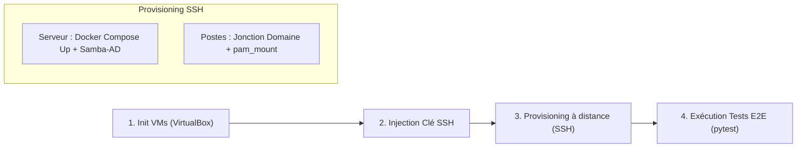

# 🧪 Stratégie de Test, Lab Virtuel & Automatisation SSH — LyuX

Pour développer, valider et tester l'écosystème LyuX de manière ultra-rapide sans dépendre de manipulations manuelles dans des fenêtres graphiques, nous utilisons une architecture de **Lab Virtuel automatisé en SSH**.

---

## 1. Principes du Lab de Test

1. **Des machines virtuelles ultra-légères** :
   - `LyuX-Server` : 4 Go RAM, 2 vCPUs, disque 40 Go.
   - `LyuX-B204-PC01`, `LyuX-B204-PC02` : 1.5 à 2 Go RAM, 1 à 2 vCPUs, disque 20 Go.
2. **Accès SSH immédiat (Zero-Click)** :
   - Dès l'installation du système de base, le service `sshd` est pré-activé et configuré avec une clé SSH autorisée (`authorized_keys`).
   - Aucune intervention manuelle au clavier ou à la souris n'est nécessaire.
3. **Orchestration et Recette 100% en Ligne de Commande** :
   - Tout le déploiement applicatif (Docker, Samba, partages, Veyon, Kiosk) est exécuté via des scripts Bash / Ansible / Python envoyés en SSH.
   - Les tests de conformité sont exécutés automatiquement par le framework de test `pytest`.

---

## 2. Matrice des Outils de Test Utilisés

| Outil | Usage dans le Lab LyuX | Pourquoi ce choix ? |
| :--- | :--- | :--- |
| **VirtualBox CLI (`VBoxManage`)** | Création, snapshots, câblage réseau et démarrage des VMs de test. | Scriptable en PowerShell/Bash, gratuit, fonctionne sur PC standard sans serveur dédié. |
| **OpenSSH (`ssh`, `scp`)** | Exécution des commandes de configuration et transfert des scripts de provisionnement. | Standard mondial de l'administration Linux, ultra-rapide et fiable. |
| **Docker & Docker Compose** | Instanciation instantanée des services web et de la base MariaDB sur le serveur. | Déploiement reproductible à l'identique en une seule commande (`docker compose up -d`). |
| **Python `pytest`** | Suite complète de 255 tests d'intégration End-to-End (E2E). | Valide en 1 seconde l'ensemble des scénarios critiques (auth, quotas, montages, Veyon, API). |
| **`smbclient` & `cifs-utils`** | Validation automatisée des droits de lecture/écriture sur `/homes` et `/classes`. | Permet de simuler un élève ou un prof et de vérifier qu'un élève ne peut pas effacer le travail d'un autre. |
| **`ldapsearch` & `kinit`** | Test des requêtes d'annuaire et des tickets Kerberos SSO. | Garantit que le contrôleur de domaine Samba-AD répond parfaitement. |
| **Uptime Kuma & Veyon CLI** | Vérification de l'écoute réseau des postes de salle (ports 11100, 389, 445). | Visualisation en temps réel de la disponibilité du matériel. |

---

## 3. Workflow de Test Automatisé en 4 Étapes



### Étape 1 : Création des VMs légères
Les VMs sont créées avec une carte connectée au réseau interne isolé `LyuX-Lab-Net` (`192.168.10.0/24`) et une carte NAT pour l'accès aux dépôts Debian et le port-forwarding SSH.

### Étape 2 : Connexion SSH sans mot de passe
L'accès s'effectue via la clé SSH d'administration :
```bash
# Exemple d'accès direct au serveur ou aux postes du lab
ssh -i ~/.ssh/id_lyux_lab -p 2200 lyux-admin@127.0.0.1
```

### Étape 3 : Déploiement des rôles par script
Les scripts de provisioning appliquent silencieusement les configurations nécessaires sans jamais avoir besoin d'ouvrir la fenêtre VirtualBox.

### Étape 4 : Validation par la suite de tests automatique
```bash
# Lancement des tests d'intégration E2E
pytest tests/e2e -v
```
Tous les 255 tests doivent être au vert (`100% PASS`).
