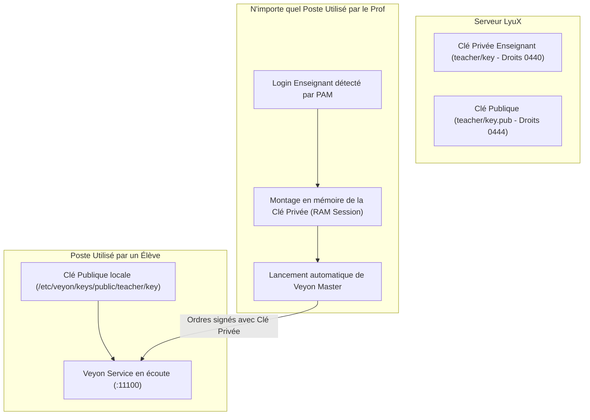

# 👁️ Supervision Pédagogique Veyon Master

> **Référence Issue GitHub** : [#9](https://github.com/Luux-Manchot/LyuX/issues/9)  
> **Décisions d'Architecture** : ADR-002, ADR-006

---

## 1. La Problématique de la Supervision en Classe

Dans une salle informatique de 30 élèves, l'enseignant doit pouvoir :
* Voir en un coup d'œil l'ensemble des écrans pour détecter les blocages ou les décrochages.
* Diffuser son propre écran en direct (mode démonstration) sur tous les postes élèves.
* Verrouiller les écrans et claviers pour capter l'attention.
* Transférer des fichiers ou envoyer un message d'instruction en direct.

**Le Défi Architectural :**  
Puisque tous les postes sont identiques et qu'un prof peut s'asseoir à n'importe quelle place, comment activer **Veyon Master** en toute sécurité sans laisser une clé d'administration accessible aux élèves ?

---

## 2. La Solution : Architecture Asymétrique par Clés RSA (ADR-006)

LyuX utilise une paire de clés cryptographiques RSA asymétriques pour garantir une sécurité absolue :

### Règles de Sécurité Imperméables
1. **Sur le poste d'un élève** : Seule la clé publique (`0444`) est présente. L'élève ne peut en aucun cas forger une commande de supervision ou espionner un camarade.
2. **Sur le poste d'un professeur** : Lors de la connexion SDDM, le script de session vérifie l'appartenance au groupe `enseignants`. La clé privée est montée de manière sécurisée en mémoire de session. L'icône **Veyon Master** apparaît automatiquement dans la barre des tâches.
3. **À la déconnexion du professeur** : La clé privée est immédiatement purgée de la mémoire. Le poste redevient un poste neutre.

---

## 3. Matrice des Ports & Fonctionnalités Veyon

| Port / Protocole | Composant Veyon | Description Fonctionnelle |
| :---: | :--- | :--- |
| **`11100 / TCP`** | **Veyon Service** | Démon d'écoute principal sur chaque poste élève. Répond aux requêtes d'état et d'affichage envoyées par Veyon Master. |
| **`11200 / TCP`** | **Veyon Feature** | Prise en charge des fonctions interactives (verrouillage de l'écran, envoi de texte, transfert de devoirs). |
| **`11300 / TCP`** | **Veyon Server** | Serveur VNC optimisé pour le streaming vidéo de l'écran de l'élève vers le master. |
| **`11400 / TCP`** | **Veyon Demo** | Diffusion de l'écran de l'enseignant en temps réel sur les écrans des élèves (plein écran ou fenêtre). |

---

## 4. Pourquoi KDE Plasma sous X11 (ADR-002) ?

Sous le protocole Wayland (utilisé par défaut sur certaines distributions modernes), chaque fenêtre est strictement isolée par le compositeur pour des raisons de sécurité, ce qui bloque le streaming d'écran et la prise en main à distance Veyon.

👉 **LyuX force l'utilisation de KDE Plasma sous session X11**, garantissant une fluidité parfaite (60 images/seconde) et une stabilité absolue de la supervision pédagogique en classe.
